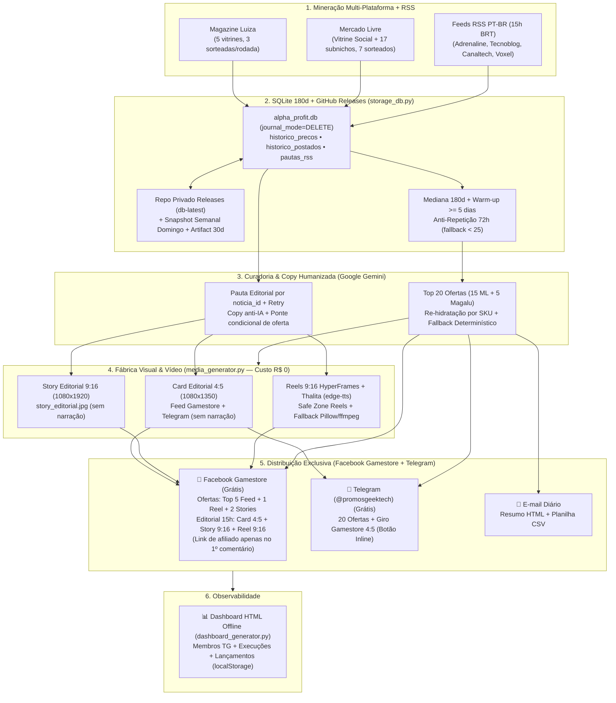

# 🚀 Alpha-Profit: Bot Multi-Canal de Afiliados & Conteúdo Tech/Gamer com IA

> **Sistema autônomo de inteligência de e-commerce, radar histórico de preços (180 dias) e motor editorial RSS.**  
> Minera ofertas no **Mercado Livre** e no **Magazine Luiza**, monitora mínimas históricas reais em SQLite (com proteção contra picos artificiais pela mediana de 180d), calcula comissões líquidas em R$, filtra repetições (72h), gera copy via **Google Gemini** e publica **3x ao dia** exclusivamente na **Página do Facebook (`Gamestore` — Feed + Stories + Reels)**, **Telegram (`@promosgeektech`)** e **E-mail**, além de gerar um **Dashboard HTML offline** e rodar **1x ao dia** (15h BRT) um **Motor Editorial RSS** com copy humanizada, **Card 4:5 (Feed + Telegram)**, **Story 9:16 sem narração** e **Reel 9:16 animado (`HyperFrames` + Thalita)**.

---

## 📌 Visão Geral e Arquitetura

O **Alpha-Profit** roda 100% serverless no **GitHub Actions** às **10h, 15h e 20h BRT** (`13:00`, `18:00` e `23:00` UTC), acionado externamente via **`cron-job.org` → GitHub API (`workflow_dispatch`)** para garantir pontualidade sem atrasos de fila do `schedule:` nativo (que permanece comentado para evitar execuções duplicadas). Por rodada, minera **20 ofertas** (**15 Mercado Livre + 5 Magalu** no Mês 1), aplica cadência anti-fadiga nos canais (**Top 3 no Feed `Gamestore` + Top 10 no Telegram**) e publica o **Motor Editorial RSS** 1x ao dia na janela das **15h BRT**.

> **Plano 90 Dias & Escopo:** Veja o roadmap completo em [ESTRATEGIA_90_DIAS.md](ESTRATEGIA_90_DIAS.md) — foco exclusivo em **Facebook (`Gamestore`) + Instagram (`Gamestore`) + Telegram (`@promosgeektech`)**, com expansão para **Amazon Brasil** no Mês 2. **WhatsApp** está fora de escopo nos Meses 1–6 (Mês 7+), e **X / Threads** permanecem desligados (`X_ENABLED=false`, `THREADS_ENABLED=false`).



---

## 🎯 Principais Funcionalidades

### 1. Mineração Multi-Plataforma + Radar de Preços 180d (`magalu_scrapper.py` & `storage_db.py`)
- **Mercado Livre:** Vitrine Social Oficial (`rafaelmelo825`) + pool rotativo de **17 subnichos** (Games, SSD NVMe, Mouse/Teclado/Monitor Gamer, Smartphones, Smartwatch, TWS, Alexa, Casa Inteligente), alternando página 1 e página 2 (`_Desde_49`).
- **Magazine Luiza (Parceiro Magalu):** Pool rotativo de 5 categorias (Informática, Games, Casa Inteligente, Celulares, Áudio) com diagnóstico explícito de bloqueios HTTP/WAF.
- **Rastreamento Automático:** Toda URL do Mercado Livre recebe `matt_tool=61727000` e `matt_word=rafaelmelo825`.
- **SQLite 180 dias (`alpha_profit.db`):**
  - Persiste `historico_precos`, `historico_postados`, `pautas_rss` e `metadados_sync` com `PRAGMA journal_mode=DELETE;` (zero arquivos `-wal`/`-shm`), restaurado e publicado via **GitHub Releases** em repositório privado (`db-latest`), com **snapshot semanal idempotente aos domingos** (`backup-YYYY-Www`) e **Artifact de 30 dias**.
  - Validação pré-upload (`PRAGMA integrity_check == 'ok'`) e guarda contra queda abrupta após expurgo de `> 180` dias.
- **Radar Anti-"Metade do Dobro":** consulta a **`mediana_180d`** *antes* de gravar os preços do dia, exigindo **warm-up `>= 5` dias observados** e `preco_atual < min_180d` para ativar `📉 MENOR PREÇO REGISTRADO!`.
- **Blindagem Gemini:** IDs curtos (`SKU`) sem exigir URLs no JSON da IA, re-hidratação determinística, recuperação parcial e top-up automático para **15 ML + 5 Magalu**.

### 2. Motor Editorial RSS Tech/Gamer (`rss_editorial.py`)
- **Execução diária desacoplada:** roda **1x/dia na janela das 15h BRT** (`14:00–16:59` em `America/Sao_Paulo`), ou sob demanda via `--run-editorial` / `--editorial-only`, de forma independente mesmo se houver bloqueio nos scrapers de loja.
- **Coleta & Deduplicação (7 dias):** lê feeds PT-BR (**Adrenaline, Tecnoblog, Canaltech, Voxel**), filtra notícias das últimas 24h, balanceia 30 candidatos por *round-robin*, extrai foto do RSS (com fallback `og:image`) e deduplica URL + similaridade temática no SQLite (`pautas_rss`).
- **Curadoria Humanizada + Parser Blindado:** usa `noticia_id` numérico curto (`1..30`), regras anti-IA (proibindo clichês e jargões vazios), ponte condicional para oferta do dia, log diagnóstico (`finish_reason` + snippet em rejeições), 1 retry automático e fallbacks por campo.
- **Três formatos automáticos por pauta (`EDITORIAL_ENABLED=true`):**
  1. **Card Feed 4:5 (`1080×1350`, sem narração):** publicado no **Feed `Gamestore`** (`/{page_id}/photos`, com link no 1º comentário só se houver match real) e no **Telegram (`@promosgeektech`)** (`EDITORIAL_TELEGRAM_ENABLED=true`).
  2. **Story 9:16 (`1080×1920`, sem narração):** salvo em `media_output/story_editorial.jpg` com safe zones de Stories e publicado via `photo_stories` (`EDITORIAL_STORY_ENABLED=true`).
  3. **Reel 9:16 animado (`1080×1920`):** narrado pela **Thalita (`edge-tts`)** via **HyperFrames** (com fallback Pillow + `ffmpeg`) respeitando Safe Zone do Facebook Reels (`224px` topo, `164px` direita, `540px` base) (`EDITORIAL_REEL_ENABLED=true`).

### 3. Fábrica de Mídia 9:16 & 4:5 (`media_generator.py` — Custo R\$ 0)
- **Motion Graphics com HeyGen HyperFrames:** vídeos determinísticos **1080×1920 @ 30fps** em HTML/GSAP para ofertas e pautas editoriais, com fallback automático em **Pillow + `ffmpeg`**.
- **Locução Neural PT-BR (`edge-tts`):** voz **`pt-BR-ThalitaMultilingualNeural`** com duração ajustada dinamicamente via `ffprobe` (`duração + 0,8s`).
- **Filtro de Nicho `Gamestore` (`_bonus_nicho_gamestore`):** prioriza Games, Hardware Gamer e Áudio nos Reels, Stories e Feed da `Gamestore`.

### 4. Distribuição Atual por Canal

| Canal | Ofertas (3x/dia) | Editorial RSS (1x/dia — 15h BRT) | Estratégia & Custo |
| :--- | :---: | :---: | :--- |
| **Facebook `Gamestore` (Feed)** | **Top 3** (Mínima Histórica + Nicho Gamer) | **1 Card 4:5** (sem narração) | Foto limpa **sem URL** + link automático no **1º comentário** — **100% Grátis** |
| **Facebook `Gamestore` (Stories)** | **2 Cards 9:16** (Nicho Gamer) | **1 Story 9:16** (sem narração) | Cards HD `1080×1920` via `photo_stories` — **100% Grátis** |
| **Facebook `Gamestore` (Reels)** | **1 MP4 9:16** (Nicho Gamer) | **1 Reel MP4 9:16** (Safe Zone) | **HyperFrames + Thalita** + link no **1º comentário** — **100% Grátis** |
| **Telegram** (`@promosgeektech`) | **Top 10** (Mínima Histórica + Queda Real) | **1 Card 4:5** (`GIRO GAMESTORE`) | Foto JPEG + Copy + Botão Inline — **100% Grátis** |
| **E-mail (Gmail)** | **20 + CSV** | — | Resumo HTML + planilha CSV — **100% Grátis** |
| **Instagram `Gamestore`** | *Mês 2* (`IG_ENABLED=false`) | *Mês 2* (`IG_ENABLED=false`) | Reuso de CDN Meta + Graph API (`/{ig_user_id}/media`) |
| **X (Twitter) / Threads** | **Desativado** | **Desativado** | `X_ENABLED=false` e `THREADS_ENABLED=false` (contas pessoais) |

### 5. Dashboard HTML Offline (`dashboard_generator.py`)
- Gerado em stdlib pura (`urllib.request`) e anexado nos **Artifacts** por 14 dias junto com `media_output/`, acompanhando evolução de membros no Telegram, execuções por canal e lançamentos manuais de vendas/comissões no `localStorage`.

---

## 📁 Estrutura de Arquivos

```text
├── .github/
│   └── workflows/
│       └── alpha-profit-bot.yml       # Pipeline Actions (Releases SQLite + Execução + Artifacts)
├── tests/
│   ├── test_storage_db.py             # Testes da camada SQLite 180d, migração e integridade
│   ├── test_radar_e_parser.py         # Testes do Radar 180d (mediana/warm-up) e parser Gemini
│   └── test_rss_editorial.py          # Testes do motor RSS (noticia_id, retry, Card 4:5, Story 9:16, Reel)
├── .gitignore                         # Ignora *.db, *.db.gz, caches e media_output/
├── GEMINI.md                          # Regras técnicas e workflow do projeto
├── ESTRATEGIA_90_DIAS.md              # Plano estratégico 90d (FB + IG + TG e Amazon Brasil)
├── magalu_scrapper.py                 # Orquestrador principal (Scrapers, Radar 180d, Gemini e Canais)
├── storage_db.py                      # Camada SQLite 180d + CLI (--init/--migrate/--cleanup/--validate)
├── rss_editorial.py                   # Motor Editorial RSS Tech/Gamer (Card 4:5 + Story 9:16 + Reel 9:16)
├── media_generator.py                 # Fábrica 4:5 e 9:16 (HyperFrames GSAP + Thalita edge-tts + Pillow)
├── dashboard_generator.py             # Gerador do Dashboard HTML offline (100% stdlib)
├── dashboard_acompanhamento.html      # Painel interativo de acompanhamento
└── README.md                          # Documentação do projeto
```

---

## ⚙️ Secrets & Variables (GitHub Actions)

Configure em `Settings` → `Secrets and variables` → `Actions`:

| Nome | Tipo | Descrição | Obrigatório |
| :--- | :---: | :--- | :---: |
| `GEMINI_API_KEY` | Secret | Chave da API do Google AI Studio (Gemini) | Sim |
| `TELEGRAM_BOT_TOKEN` | Secret | Token do bot gerado no `@BotFather` | Sim |
| `TELEGRAM_CHAT_ID` | Secret | Identificador do canal (ex: `@promosgeektech`) | Sim |
| `FACEBOOK_PAGE_TOKEN` | Secret | Token da Página `Gamestore` (`PAGE_ID` resolvido via `/me/accounts` ou `/me`) | Sim |
| `EMAIL_USER` | Secret | E-mail remetente (Gmail) | Sim |
| `EMAIL_PASSWORD` | Secret | Senha de aplicativo do Gmail (16 dígitos) | Sim |
| `DATA_REPO_TOKEN` | Secret | Token (PAT) com permissão `Contents: Read & Write` no repo privado de dados | Recomendado |
| `DATA_REPO_OWNER_NAME` | Variable | Repo privado das Releases do SQLite (ex: `usuario/alpha-profit-data`) | Recomendado |
| `FACEBOOK_MAX_POSTS` / `TELEGRAM_MAX_POSTS` | Env (Workflow) | Limites anti-fadiga por rodada (`3` no Feed FB, `10` no Telegram) | Configurado |
| `IG_ENABLED` / `AMAZON_ENABLED` | Env (Workflow) | Flags de preparação para Mês 2 (`false` na Semana 1) | Configurado |
| `X_*` / `THREADS_ACCESS_TOKEN` | Secret | Mantidos opcionais/inativos (`X_ENABLED=false`, `THREADS_ENABLED=false`) | Não |

---

## 🛠️ Instalação, Execução & Testes Locais

```bash
git clone https://github.com/rdsmelobsb/bot_afiliados_magalu.git
cd bot_afiliados_magalu

python -m venv venv
# Windows:
venv\Scripts\activate
# Linux/Mac:
source venv/bin/activate

pip install pandas requests beautifulsoup4 google-generativeai pillow edge-tts feedparser
npm install -g hyperframes   # Opcional (requer Node.js 22+ e FFmpeg; sem ele usa fallback Pillow+ffmpeg)

# Execução completa (ofertas + editorial na janela das 15h BRT)
python magalu_scrapper.py

# Forçar apenas o bloco editorial RSS (sem raspar lojas)
python magalu_scrapper.py --editorial-only

# Rodar toda a suíte de testes unitários (funciona no Windows sem dependências pesadas extras)
python -m unittest discover -s tests -v
```

Para regenerar apenas o dashboard localmente:
```bash
python dashboard_generator.py
```

---

## 📈 Roadmap

- [x] Motor de raspagem multi-plataforma (Mercado Livre + Magalu) com rotação de vitrines e diagnóstico HTTP/WAF.
- [x] Persistência **SQLite 180 dias** (`storage_db.py`) com backup via GitHub Releases privadas + snapshot semanal + Artifact 30d.
- [x] Radar de Preços 180d com proteção por mediana + warm-up `>= 5` dias e trava anti-repetição de 72h.
- [x] Foco exclusivo em **Facebook `Gamestore` (Feed + Stories + Reels)**, **Telegram (`@promosgeektech`)** e **E-mail** (X e Threads desativados).
- [x] Fábrica **HyperFrames + Thalita (`edge-tts`)** com Safe Zone de Reels + Cards 4:5 e Stories 9:16 sem narração.
- [x] **Motor Editorial RSS** diário com copy humanizada anti-IA, `noticia_id`, retry automático e Card 4:5 + Story 9:16 + Reel 9:16.
- [x] Suíte de testes automatizados (`tests/test_storage_db.py`, `tests/test_radar_e_parser.py`, `tests/test_rss_editorial.py`).
- [x] Calibração anti-fadiga Semana 1 (FB Top 3 + TG Top 10) e plano de 90 dias (`ESTRATEGIA_90_DIAS.md`) com agendamento via `cron-job.org`.
- [ ] Mês 1–2: Publicação automática no Instagram Profissional (`IG_ENABLED=true`) via reuso de CDN Meta.
- [ ] Mês 2: Integração Amazon Brasil (`AMAZON_ENABLED=true`, prefixo `AMZ_`, Radar 180d).
- [ ] Mês 3: Dashboard v2 consolidado + CRO orientado a dados.
- [ ] Mês 7+: Canal/Comunidade no WhatsApp (fora de escopo nos Meses 1–6).

---

## 👨‍💻 Autor

Desenvolvido por **Rafael Melo**  
Canal Oficial de Ofertas: [t.me/promosgeektech](https://t.me/promosgeektech)  
Loja Parceiro Magalu: [Magazine Você Dealz](https://www.magazinevoce.com.br/magazinedealz/)  
Perfil Social Mercado Livre: [RAFAELMELO825](https://www.mercadolivre.com.br/social/rafaelmelo825)
