# 🚀 Alpha-Profit: Bot Multi-Canal de Afiliados com IA (Mercado Livre & Magalu)

> **Sistema autônomo de inteligência de e-commerce, arbitragem de ofertas e distribuição multi-canal.**  
> Minera oportunidades no **Mercado Livre** e no **Magazine Luiza**, calcula comissões líquidas reais em R$, filtra repetições (72h), gera copy persuasiva com Inteligência Artificial (**Google Gemini**) e publica automaticamente **3x ao dia** no **Telegram**, **Threads**, **Página do Facebook**, **X (Twitter)** e **E-mail**, além de gerar um **Dashboard HTML de Acompanhamento**.

---

## 📌 Visão Geral e Arquitetura

O **Alpha-Profit** roda 100% serverless no **GitHub Actions** às **10h, 15h e 20h (BRT)**, selecionando **20 ofertas inéditas por execução** (**15 Mercado Livre + 5 Magalu**) e distribuindo cada uma no formato ideal para o algoritmo e custo de cada rede social.

```mermaid
flowchart TD
    subgraph Coleta ["1. Mineração Multi-Plataforma + Rotação"]
        M1["Magazine Luiza<br/>(Pool de 5 vitrines, 3 sorteadas/rodada)"]
        M2["Mercado Livre<br/>(Vitrine Social + 17 subnichos, 7 sorteados/rodada)"]
    end

    subgraph Inteligencia ["2. Lucratividade & Anti-Repetição"]
        F1["Histórico 72h (historico_postados.json via Cache)"]
        F2["Cálculo de Comissão (1P/3P) + Lucro em R$"]
        F3["Score Composto + Jitter de Diversidade"]
    end

    subgraph EstrategiaIA ["3. Curadoria & Copywriting (Gemini)"]
        IA["Google Gemini<br/>Alpha-Profit C-Level Prompt"]
        COPY["Top 20 Ofertas (15 ML + 5 Magalu)<br/>+ Copy Persuasiva (AIDA)"]
    end

    subgraph Distribuicao ["4. Canais de Distribuição (3x/dia)"]
        TG["📢 Telegram (@promosgeektech)<br/>20 ofertas • Foto JPEG + Botão Afiliado"]
        TH["🧵 Threads (Meta — Grátis)<br/>Top 5 • Foto/Preview + Link Direto"]
        FB["📘 Página do Facebook (Meta — Grátis)<br/>Top 5 • Foto Limpa + Link no 1º Comentário"]
        TW["🐦 X / Twitter (Modo Econômico)<br/>Top 2 • Foto JPEG sem URLs (~US$ 0,015/post)"]
        EMAIL["📧 E-mail Diário<br/>Resumo HTML + Planilha CSV Completa"]
    end

    subgraph Tracking ["5. Observabilidade & Métricas"]
        DASH["📊 Dashboard HTML Automático<br/>Membros TG + Execuções + Vendas Reais (localStorage)"]
    end

    Coleta --> Inteligencia
    Inteligencia --> EstrategiaIA
    EstrategiaIA --> Distribuicao
    Distribuicao --> Tracking
```



---

## 🎯 Principais Funcionalidades

### 1. Mineração Multi-Plataforma com Rotação Anti-Repetição
- **Mercado Livre:** Vitrine Social Oficial (`rafaelmelo825`) + pool rotativo de **17 subnichos** (Games, SSD NVMe, Mouse/Teclado/Monitor Gamer, Smartphones, Smartwatch, TWS, Alexa, Casa Inteligente), alternando página 1 e página 2 (`_Desde_49`).
- **Magazine Luiza (Parceiro Magalu):** Pool rotativo de 5 categorias (Informática, Games, Casa Inteligente, Celulares, Áudio) com paginação dinâmica.
- **Rastreamento Automático:** Toda URL do Mercado Livre recebe automaticamente `matt_tool=61727000` e `matt_word=rafaelmelo825`.
- **Anti-Repetição (72h):** Persistência de SKUs já publicados em `historico_postados.json` via `actions/cache@v4`, combinada com *jitter* de diversidade no ranking.

### 2. Motor de Comissões e Lucro Real
- **Detecção de Vendedor (1P vs 3P):** Aplica a tabela oficial de comissão conforme categoria e tipo de vendedor.
- **Conversão de Imagens em Memória (Pillow):** Ignora placeholders `data:image/...`, baixa os bytes originais (inclusive `.webp` do `mlstatic.com`) e converte para **JPEG genuíno em memória** antes do upload multipart para Telegram, X e Facebook.

### 3. Distribuição Multi-Canal Otimizada (3x ao Dia)

| Canal | Ofertas / Execução | Ofertas / Dia | Estratégia & Custo |
| :--- | :---: | :---: | :--- |
| **Telegram** (`@promosgeektech`) | **20** (15 ML + 5 Magalu) | **60** | Foto JPEG + Copy + Botão Inline — **100% Grátis** |
| **Threads** (Meta) | **Top 5** | **15** | Link direto + Foto (ou fallback `link_attachment`) — **100% Grátis** |
| **Página do Facebook** (Meta) | **Top 5** | **15** | Foto limpa **sem link** + **link automático no 1º comentário** (anti-restrição de alcance) — **100% Grátis** |
| **X (Twitter)** | **Top 2** | **6** | **Modo Econômico** (foto JPEG + `@promosgeektech` na bio, **zero URLs** para evitar taxa de US\$ 0,20/post) — **~US\$ 0,015/post** |
| **E-mail (Gmail)** | **20 + CSV** | **3** | Resumo HTML completo + planilha CSV com todo o catálogo raspado — **100% Grátis** |

### 4. Dashboard HTML de Acompanhamento (`dashboard_generator.py`)
- Gerado automaticamente ao final de cada rodada e anexado nos **Artifacts** do GitHub Actions (por 14 dias) como `dashboard_acompanhamento.html`.
- **Aba 1 — Operação do Bot (Automático):** evolução de membros do Telegram (`getChatMemberCount`), total de posts por canal (Telegram, Threads, Facebook, X), categorias mais mineradas, custo estimado da API do X e status de cada execução.
- **Aba 2 — Vendas & Comissões Reais (Manual):** formulário salvo no `localStorage` do navegador para registrar cliques, vendas e comissões reais do Mercado Livre e Magalu, calculando **Lucro Líquido vs API X** e **Taxa de Conversão**, com **Backup/Importação JSON** e **Exportar CSV**.

---

## 📁 Estrutura de Arquivos

```text
├── .github/
│   └── workflows/
│       └── alpha-profit-bot.yml       # Pipeline GitHub Actions (3x/dia: 10h, 15h e 20h BRT)
├── .gitignore                         # Ignora caches, ambientes e históricos locais
├── GEMINI.md                          # Diretrizes técnicas e regras de workflow do projeto
├── magalu_scrapper.py                 # Motor principal (Scraper, IA, Telegram, X, Threads, Facebook e E-mail)
├── dashboard_generator.py             # Coletor de telemetria e gerador do Dashboard HTML offline
├── dashboard_acompanhamento.html      # Painel interativo de acompanhamento (abre direto no navegador)
└── README.md                          # Documentação técnica do projeto
```

---

## ⚙️ Variáveis de Ambiente & Secrets (GitHub Actions)

Configure os **Repository Secrets** em `Settings` → `Secrets and variables` → `Actions`:

| Variável | Descrição | Obrigatório |
| :--- | :--- | :---: |
| `GEMINI_API_KEY` | Chave de API do Google AI Studio (Gemini) | Sim |
| `TELEGRAM_BOT_TOKEN` | Token do bot gerado pelo `@BotFather` no Telegram | Sim |
| `TELEGRAM_CHAT_ID` | Identificador do canal público (ex: `@promosgeektech`) | Sim |
| `EMAIL_USER` | E-mail remetente (Gmail) | Sim |
| `EMAIL_PASSWORD` | Senha de aplicativo do Gmail (App Password de 16 dígitos) | Sim |
| `THREADS_ACCESS_TOKEN` | Token da API do Threads (`USER_ID` descoberto via `/me`) | Opcional |
| `FACEBOOK_PAGE_TOKEN` | Token da Página do Facebook (`PAGE_ID` descoberto via `/me`) | Opcional |
| `X_API_KEY` | Consumer Key (OAuth 1.0a) do X Developer Portal | Opcional |
| `X_API_SECRET` | Consumer Secret (OAuth 1.0a) do X Developer Portal | Opcional |
| `X_ACCESS_TOKEN` | Access Token (Read & Write) do X | Opcional |
| `X_ACCESS_TOKEN_SECRET` | Access Token Secret do X | Opcional |

> Todos os canais sociais opcionais degradam de forma segura: se um secret não estiver configurado, o bot ignora aquele canal sem interromper os demais.

---

## 🛠️ Instalação e Execução Local

```bash
git clone https://github.com/rdsmelobsb/bot_afiliados_magalu.git
cd bot_afiliados_magalu

python -m venv venv
# Windows:
venv\Scripts\activate
# Linux/Mac:
source venv/bin/activate

pip install pandas requests beautifulsoup4 google-generativeai pillow tweepy
python magalu_scrapper.py
```

Para regenerar apenas o dashboard localmente (sem dependências externas):
```bash
python dashboard_generator.py
```

---

## 📈 Roadmap

- [x] Motor de raspagem multi-plataforma (Mercado Livre + Magalu) com paginação e rotação de categorias.
- [x] Cálculo oficial de comissões (1P/3P) e lucro estimado em R$.
- [x] Histórico anti-repetição de 72h persistido via `actions/cache@v4`.
- [x] Conversão automática de imagens `.webp` para JPEG via Pillow.
- [x] Disparo automático 3x ao dia no **Telegram**, **Threads**, **Página do Facebook** (link no 1º comentário) e **X** (Modo Econômico).
- [x] Dashboard HTML de acompanhamento (telemetria automática + lançamentos manuais de vendas reais).
- [ ] Integração com Canal/Grupo no WhatsApp.
- [ ] Módulo de histórico de preços para validação de "mínima dos últimos 30 dias".
- [ ] Integração com o Programa de Associados da Amazon Brasil.

---

## 👨‍💻 Autor

Desenvolvido por **Rafael Melo**  
Canal Oficial de Ofertas: [t.me/promosgeektech](https://t.me/promosgeektech)  
Loja Parceiro Magalu: [Magazine Você Dealz](https://www.magazinevoce.com.br/magazinedealz/)  
Perfil Social Mercado Livre: [RAFAELMELO825](https://www.mercadolivre.com.br/social/rafaelmelo825)
