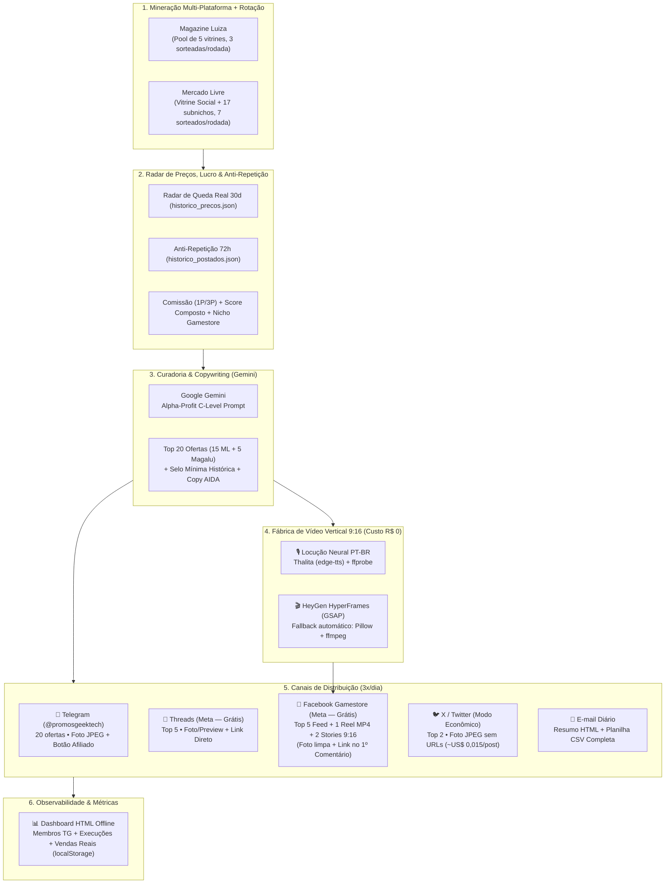

# 🚀 Alpha-Profit: Bot Multi-Canal de Afiliados com IA (Mercado Livre & Magalu)

> **Sistema autônomo de inteligência de e-commerce, radar de quedas reais de preço e distribuição multi-canal (incluindo Reels animados narrados por IA).**  
> Minera oportunidades no **Mercado Livre** e no **Magazine Luiza**, monitora mínimas históricas de 30 dias, calcula comissões líquidas em R$, filtra repetições (72h), gera copy persuasiva (**Google Gemini**) e publica automaticamente **3x ao dia** no **Telegram**, **Threads**, **Página do Facebook (`Gamestore` — Feed + Reels + Stories)**, **X (Twitter)** e **E-mail**, além de gerar um **Dashboard HTML de Acompanhamento**.

---

## 📌 Visão Geral e Arquitetura

O **Alpha-Profit** roda 100% serverless no **GitHub Actions** às **10h, 15h e 20h (BRT)**, selecionando **20 ofertas inéditas por execução** (**15 Mercado Livre + 5 Magalu**) e distribuindo cada uma no formato ideal para o algoritmo e custo de cada plataforma.



---

## 🎯 Principais Funcionalidades

### 1. Mineração Multi-Plataforma + Radar de Queda Real (Modo Híbrido — 30 dias)
- **Mercado Livre:** Vitrine Social Oficial (`rafaelmelo825`) + pool rotativo de **17 subnichos** (Games, SSD NVMe, Mouse/Teclado/Monitor Gamer, Smartphones, Smartwatch, TWS, Alexa, Casa Inteligente), alternando página 1 e página 2 (`_Desde_49`).
- **Magazine Luiza (Parceiro Magalu):** Pool rotativo de 5 categorias (Informática, Games, Casa Inteligente, Celulares, Áudio) com paginação dinâmica.
- **Rastreamento Automático:** Toda URL do Mercado Livre recebe automaticamente `matt_tool=61727000` e `matt_word=rafaelmelo825`.
- **Radar de Preços (`historico_precos.json`):** monitora até 5.000 SKUs nos últimos 30 dias sem reduzir o volume de 20 ofertas. Itens em mínima real ganham bônus máximo no ranking, assumem os canais VIP (Reel + X) e exibem o selo **`📉 MENOR PREÇO REGISTRADO!`** com a média anterior.
- **Anti-Repetição (72h):** Persistência de SKUs já publicados em `historico_postados.json` via `actions/cache@v4`, combinada com *jitter* de diversidade.

### 2. Fábrica de Reels Animados & Stories 9:16 (`media_generator.py` — Custo R\$ 0)
- **Motion Graphics com HeyGen HyperFrames:** renderiza vídeos determinísticos **1080×1920 @ 30fps** em HTML/GSAP (selo da loja, badge pulsante de desconto, foto em destaque, preço antigo riscando ao vivo, preço novo neon e botão CTA com shimmer).
- **Locução Neural em PT-BR (`edge-tts`):** narração automática com a voz **`pt-BR-ThalitaMultilingualNeural`** (pronúncia natural de termos gamer/tech) e duração ajustada dinamicamente via `ffprobe` (`duração + 0,8s`) para nunca cortar a fala.
- **Fallback Automático:** caso o HyperFrames não esteja disponível, cai suavemente para **Pillow + `ffmpeg`** (zoom suave + voz da Thalita).
- **Filtro de Nicho `Gamestore` (`_bonus_nicho_gamestore`):** prioriza **Games, Hardware Gamer e Áudio** nos Reels, Stories e Feed da Página `Gamestore`, penalizando itens de casa (*fechadura, cadeado, vitrola*).

### 3. Distribuição Multi-Canal Otimizada (3x ao Dia)

| Canal | Volume / Execução | Volume / Dia | Estratégia & Custo |
| :--- | :---: | :---: | :--- |
| **Telegram** (`@promosgeektech`) | **20** (15 ML + 5 Magalu) | **60** | Foto JPEG (Pillow) + Copy + Botão Inline — **100% Grátis** |
| **Threads** (Meta) | **Top 5** | **15** | Link direto + Foto (ou fallback `link_attachment`) — **100% Grátis** |
| **Facebook `Gamestore` (Feed)** | **Top 5** (Nicho Gamer) | **15** | Foto limpa **sem link** + **link automático no 1º comentário** — **100% Grátis** |
| **Facebook `Gamestore` (Reels)** | **1 MP4 9:16** (Nicho Gamer) | **3** | **HyperFrames + Thalita** + link automático no 1º comentário — **100% Grátis** |
| **Facebook `Gamestore` (Stories)** | **2 Cards 9:16** (Nicho Gamer) | **6** | Cards HD 1080×1920 via `photo_stories` — **100% Grátis** |
| **X (Twitter)** | **Top 2** | **6** | **Modo Econômico** (foto JPEG + `@promosgeektech` na bio, **zero URLs** para evitar taxa de US\$ 0,20/post) — **~US\$ 0,015/post** |
| **E-mail (Gmail)** | **20 + CSV** | **3** | Resumo HTML completo + planilha CSV com todo o catálogo raspado — **100% Grátis** |

### 4. Dashboard HTML de Acompanhamento (`dashboard_generator.py`)
- Gerado automaticamente ao final de cada rodada (usando apenas stdlib Python) e anexado nos **Artifacts** do GitHub Actions por 14 dias junto com os MP4s/Stories em `media_output/`.
- **Aba 1 — Operação do Bot (Automático):** evolução de membros do Telegram (`getChatMemberCount`), posts por canal (Telegram, Threads, Facebook, X), categorias mais mineradas, custo estimado do X e status de cada execução.
- **Aba 2 — Vendas & Comissões Reais (Manual):** formulário salvo no `localStorage` do navegador para lançar cliques, vendas e comissões reais do Mercado Livre e Magalu, calculando **Lucro Líquido vs API X** e **Taxa de Conversão**, com **Backup/Importação JSON** e **Exportar CSV**.

---

## 📁 Estrutura de Arquivos

```text
├── .github/
│   └── workflows/
│       └── alpha-profit-bot.yml       # Pipeline GitHub Actions (3x/dia: 10h, 15h e 20h BRT)
├── .gitignore                         # Ignora caches, media_output/ e históricos JSON locais
├── GEMINI.md                          # Diretrizes técnicas e invariantes de desenvolvimento
├── magalu_scrapper.py                 # Motor principal (Scraper, Radar 30d, IA e Disparos Multi-Canal)
├── media_generator.py                 # Fábrica de Reels 9:16 (HyperFrames + Thalita edge-tts + Fallback Pillow/ffmpeg)
├── dashboard_generator.py             # Coletor de telemetria e gerador do Dashboard HTML offline
├── dashboard_acompanhamento.html      # Painel interativo de acompanhamento (abre direto no navegador)
└── README.md                          # Documentação técnica do projeto
```

---

## ⚙️ Variáveis de Ambiente & Secrets (GitHub Actions)

Configure os **Repository Secrets** em `Settings` → `Secrets and variables` → `Actions`:

| Variável | Descrição | Obrigatório |
| :--- | :--- | :---: |
| `GEMINI_API_KEY` | Chave de API do Google AI Studio (Gemini) | Sim |
| `TELEGRAM_BOT_TOKEN` | Token do bot gerado pelo `@BotFather` no Telegram | Sim |
| `TELEGRAM_CHAT_ID` | Identificador do canal público (ex: `@promosgeektech`) | Sim |
| `EMAIL_USER` | E-mail remetente (Gmail) | Sim |
| `EMAIL_PASSWORD` | Senha de aplicativo do Gmail (App Password de 16 dígitos) | Sim |
| `THREADS_ACCESS_TOKEN` | Token da API do Threads (`USER_ID` descoberto via `/me`) | Opcional |
| `FACEBOOK_PAGE_TOKEN` | Token da Página `Gamestore` (`PAGE_ID` e Page Token resolvidos via `/me/accounts` ou `/me`) | Opcional |
| `X_API_KEY` | Consumer Key (OAuth 1.0a) do X Developer Portal | Opcional |
| `X_API_SECRET` | Consumer Secret (OAuth 1.0a) do X Developer Portal | Opcional |
| `X_ACCESS_TOKEN` | Access Token (Read & Write) do X | Opcional |
| `X_ACCESS_TOKEN_SECRET` | Access Token Secret do X | Opcional |

> Todos os canais sociais opcionais degradam de forma segura: se um secret não estiver configurado, o bot ignora aquele canal sem interromper os demais.

---

## 🛠️ Instalação e Execução Local

```bash
git clone https://github.com/rdsmelobsb/bot_afiliados_magalu.git
cd bot_afiliados_magalu

python -m venv venv
# Windows:
venv\Scripts\activate
# Linux/Mac:
source venv/bin/activate

pip install pandas requests beautifulsoup4 google-generativeai pillow tweepy edge-tts
npm install -g hyperframes   # Opcional (requer Node.js 22+ e FFmpeg; sem ele usa fallback Pillow+ffmpeg)

python magalu_scrapper.py
```

Para regenerar apenas o dashboard localmente (zero dependências externas):
```bash
python dashboard_generator.py
```

---

## 📈 Roadmap

- [x] Motor de raspagem multi-plataforma (Mercado Livre + Magalu) com paginação e rotação de categorias.
- [x] Cálculo oficial de comissões (1P/3P) e lucro estimado em R$.
- [x] Histórico anti-repetição de 72h persistido via `actions/cache@v4`.
- [x] Radar de Queda Real de Preço (histórico de 30 dias — Modo Híbrido + selo `📉 MENOR PREÇO REGISTRADO!`).
- [x] Conversão automática de imagens `.webp` para JPEG via Pillow.
- [x] Disparo automático 3x ao dia no **Telegram**, **Threads**, **Página do Facebook `Gamestore`** (link no 1º comentário + filtro de nicho Gamer) e **X** (Modo Econômico).
- [x] Fábrica automática de **Reels 9:16 animados (HyperFrames + Thalita `edge-tts`)** e **Stories 9:16** na Página `Gamestore`.
- [x] Dashboard HTML de acompanhamento (telemetria automática + lançamentos manuais de vendas reais).
- [ ] Publicação automática de Reels/Stories no Instagram Profissional (`instagram_content_publish`).
- [ ] Integração com Canal/Grupo no WhatsApp.
- [ ] Integração com o Programa de Associados da Amazon Brasil.

---

## 👨‍💻 Autor

Desenvolvido por **Rafael Melo**  
Canal Oficial de Ofertas: [t.me/promosgeektech](https://t.me/promosgeektech)  
Loja Parceiro Magalu: [Magazine Você Dealz](https://www.magazinevoce.com.br/magazinedealz/)  
Perfil Social Mercado Livre: [RAFAELMELO825](https://www.mercadolivre.com.br/social/rafaelmelo825)
