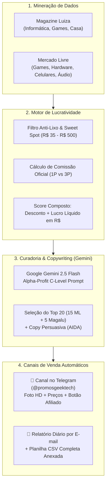

# 🚀 Alpha-Profit: Bot de Afiliados com IA (Magalu & Mercado Livre)

> **Sistema autônomo de inteligência de e-commerce e arbitragem de ofertas.**  
> Minera oportunidades no Magazine Luiza e no Mercado Livre, calcula comissões líquidas reais em R$, gera copy persuasiva com Inteligência Artificial (Google Gemini) e publica automaticamente no Telegram e por e-mail.

---

## 📌 Visão Geral do Projeto

O **Alpha-Profit** foi arquitetado para transformar a afiliação tradicional de e-commerce em uma operação 100% automatizada e orientada a dados. Em vez de garimpar promoções manualmente, o sistema roda na nuvem diariamente, analisando centenas de produtos em tempo real para encontrar as maiores margens de lucro e os descontos mais agressivos.



---

## 🎯 Principais Funcionalidades

### 1. Mineração Multi-Plataforma
- **Magazine Luiza (Parceiro Magalu):** Raspagem das vitrines oficiais de Informática, Games e Casa Inteligente.
- **Mercado Livre:** Varredura em 5 categorias de alto volume:
  - *Games & Consoles* (Playstation, Xbox, Nintendo, Acessórios).
  - *Informática & Hardware* (SSDs, memórias, periféricos gamer, monitores).
  - *Celulares & Smartphones* (Aparelhos e marcas de alta conversão).
  - *Áudio & Gadgets Geek* (Fones TWS, smartbands, caixas de som).
  - *Casa Inteligente & Setup* (Lâmpadas inteligentes, fitas LED RGB, suportes articulados).
- **Injeção Automática de Rastreamento:** Links convertidos dinamicamente com as tags de afiliado (`matt_tool` e `matt_word`).

### 2. Motor de Comissões e Lucro Real
- **Detecção de Vendedor (1P vs 3P):** Diferencia estoque próprio da plataforma de vendedores terceiros (Marketplace), aplicando a tabela percentual oficial exata.
- **Cálculo de Lucro Líquido:** Avalia o retorno financeiro real por venda (`lucro_estimado_reais = preco_atual * (comissao_percent / 100)`).
- **Ranking Inteligente (`score_qualidade`):**
  $$\text{Score} = (\text{Desconto \%} \times 0.35) + (\text{Lucro em R\$} \times 0.40) + (\text{Sweet Spot} \times 25)$$
  Prioriza itens que colocam mais dinheiro no bolso, e não apenas números de desconto maquiados.

### 3. Copywriting Persuasivo com IA (Google Gemini)
- Prompt estrategista desenhado com frameworks de persuasão (Problema + Solução + Escassez + Chamada para Ação).
- Títulos magnéticos com limite de caracteres para alta leitura mobile.

### 4. Publicação Automática no Telegram
- Disparo de cards visuais para o canal [t.me/promosgeektech](https://t.me/promosgeektech).
- Fotos dos produtos otimizadas em alta resolução (800x600).
- Identificação visual imediata:
  - `🟡 [MERCADO LIVRE - FULL]` com botão direto para o Mercado Livre.
  - `🔵 [MAGALU]` com botão direto para o Parceiro Magalu.
- Intervalo de segurança anti-flood e contingência automática em texto caso a imagem falhe.

### 5. Execução 100% Gratuita e Serverless
- Orquestrado via **GitHub Actions** em horários programados (Cron Job diário).
- Não requer contratação de VPS ou servidores dedicados.

---

## 📁 Estrutura de Arquivos

```text
├── .github/
│   └── workflows/
│       └── alpha-profit-bot.yml    # Pipeline CI/CD de automação diária no GitHub Actions
├── .gitignore                      # Arquivos ignorados pelo Git (caches, logs, envs)
├── magalu_scrapper.py              # Script principal (Scraper, Cálculo, IA e Disparos)
└── README.md                       # Documentação técnica do projeto
```

---

## ⚙️ Variáveis de Ambiente & Secrets

Para que o robô funcione na nuvem, configure os seguintes **Repository Secrets** no GitHub (`Settings` -> `Secrets and variables` -> `Actions`):

| Variável | Descrição | Obrigatório |
| :--- | :--- | :---: |
| `GEMINI_API_KEY` | Chave de API do Google AI Studio (Gemini) | Sim |
| `TELEGRAM_BOT_TOKEN` | Token do bot gerado pelo `@BotFather` no Telegram | Sim |
| `TELEGRAM_CHAT_ID` | Identificador do canal público (ex: `@promosgeektech`) | Sim |
| `EMAIL_USER` | E-mail remetente para envio do relatório (Gmail) | Sim |
| `EMAIL_PASSWORD` | Senha de aplicativo do Gmail (App Password de 16 dígitos) | Sim |

---

## 🛠️ Instalação e Execução Local

Caso deseje executar ou testar o script localmente no seu computador:

1. **Clone o repositório:**
   ```bash
   git clone https://github.com/rdsmelobsb/bot_afiliados_magalu.git
   cd bot_afiliados_magalu
   ```

2. **Crie e ative um ambiente virtual:**
   ```bash
   python -m venv venv
   # No Windows:
   venv\Scripts\activate
   # No Linux/Mac:
   source venv/bin/activate
   ```

3. **Instale as dependências:**
   ```bash
   pip install pandas requests beautifulsoup4 google-generativeai
   ```

4. **Defina as variáveis de ambiente:**
   ```bash
   # Windows (PowerShell):
   $env:GEMINI_API_KEY="SUA_CHAVE_GEMINI"
   $env:TELEGRAM_BOT_TOKEN="SEU_TOKEN_TELEGRAM"
   $env:TELEGRAM_CHAT_ID="@promosgeektech"
   $env:EMAIL_USER="seu-email@gmail.com"
   $env:EMAIL_PASSWORD="sua-senha-de-app"
   ```

5. **Execute o script:**
   ```bash
   python magalu_scrapper.py
   ```

---

## 📈 Roadmap & Próximos Passos

- [x] Motor de raspagem com paginação dinâmica.
- [x] Cálculo oficial de comissões para Parceiro Magalu.
- [x] Integração com Telegram Bot API com fotos HD e botões inline.
- [x] Integração multi-plataforma com o Mercado Livre (5 categorias).
- [ ] Módulo de histórico de preços para validação de "mínima dos últimos 30 dias".
- [ ] Integração com o Programa de Associados da Amazon Brasil.
- [ ] Notificação instantânea para erros de preço ("Bug de Oferta / Corre").

---

## 👨‍💻 Autor

Desenvolvido por **Rafael Melo**  
Canal Oficial de Ofertas: [t.me/promosgeektech](https://t.me/promosgeektech)  
Loja Parceiro Magalu: [Magazine Você Dealz](https://www.magazinevoce.com.br/magazinedealz/)  
Perfil Social Mercado Livre: [RAFAELMELO825](https://www.mercadolivre.com.br/social/rafaelmelo825)
